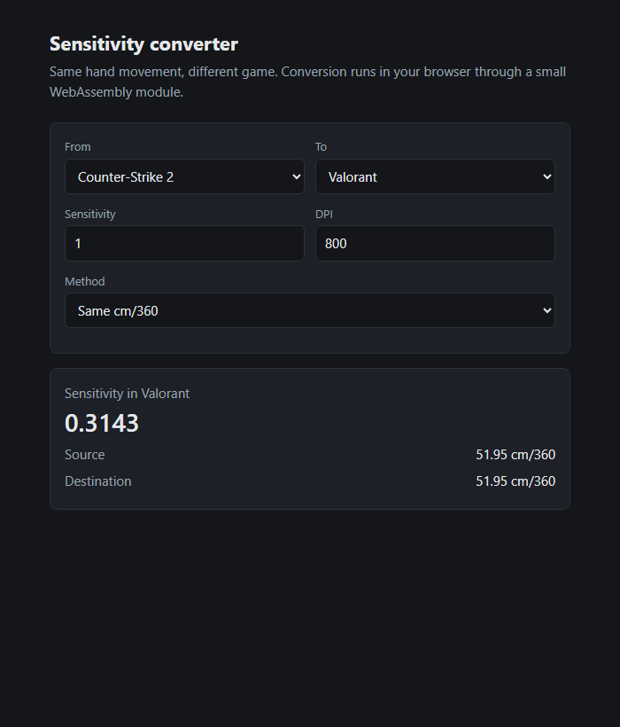
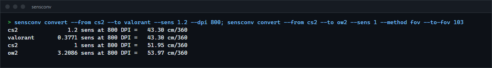

# Sensitivity converter

Converts mouse sensitivity between games so your aim feels the same everywhere. A command line tool and a static web page share one small Rust core, driven by a plain JSON file of per-game yaw values.

**Status:** v0.1.0, working. Not published to crates.io; build from source.



## Features

- Same-distance conversion (cm/360) between 12 games, with separate DPI for each side.
- FOV matching: match a chosen point on screen (centre, edge or anything between) when the two games use different horizontal FOVs.
- Per-game constants live in `data/games.json`; add a game by adding one object.
- The web page runs the same Rust code as a 9 KB WebAssembly module, no server logic.

## How to install

Needs a Rust toolchain.

```sh
git clone https://github.com/r3clusionn/sensitivity-converter
cd sensitivity-converter
cargo install --path .
```

For the web page, build the module once and serve the `web/` folder over HTTP:

```sh
rustup target add wasm32-unknown-unknown
./scripts/build-web.ps1
cd web && python -m http.server
```

## How to use

```sh
sensconv list
sensconv cm360 --game cs2 --sens 1.2 --dpi 800
sensconv convert --from cs2 --to valorant --sens 1.2 --dpi 800
sensconv convert --from cs2 --to ow2 --sens 1 --method fov --to-fov 103 --coefficient 0.75
```

Example output of the last command:

```text
cs2                 1 sens at 800 DPI =   51.95 cm/360
ow2            3.2086 sens at 800 DPI =   53.97 cm/360
```

| Option | What it does |
|---|---|
| `--from`, `--to` | Game ids from `sensconv list`. |
| `--sens` | Sensitivity in the source game. |
| `--dpi`, `--to-dpi` | Mouse DPI for each side. `--to-dpi` defaults to `--dpi`. |
| `--method` | `cm360` (default) or `fov`. |
| `--coefficient` | FOV match point from 0 (screen centre) to 1 (screen edge). Default 0.75. |
| `--from-fov`, `--to-fov` | Horizontal FOV in degrees. Games with a fixed FOV supply it; others need the flag. |
| `--games FILE` | Use your own games file. |



## How it works

A game turns `yaw * sensitivity` degrees per mouse count, so one 360 degree turn takes
`360 / (yaw * sens * dpi)` inches. Cm/360 conversion keeps that distance equal and solves for the
destination sensitivity.

FOV matching picks a point at fraction `c` of the half-screen width and scales cm/360 by
`atan(c * tan(src_fov / 2)) / atan(c * tan(dst_fov / 2))`. At `c = 0` this is the ratio of the FOV
tangents, at `c = 1` the ratio of the FOV angles.

## Data and accuracy

The yaw constants come from widely published community values, not from measurements made here.
Games that apply extra multipliers (ADS, per-scope) are converted at their base yaw only. Check a
new game by comparing a 360 turn in game against the cm/360 this tool prints. Corrections are
welcome as a one-line change to `data/games.json`.

## Tests

`cargo test` runs 13 tests: known conversions, round trips, FOV edge cases, input validation of the
C interface, games file validation, and a check that `web/games.json` matches `data/games.json`.

## License

MIT (see `LICENSE`).
